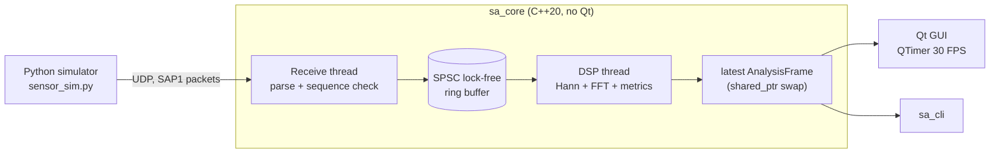

# Signal Analyzer

Real-time vibration signal analyzer: a Python sensor simulator streams samples over UDP,
a multithreaded C++20 pipeline computes the spectrum and signal metrics, and a Qt 6
desktop app displays the waveform and FFT live.

<!-- TODO: add a GIF of the running app here -->

## Features

- **Lock-free SPSC ring buffer** between the network and DSP threads (acquire/release
  atomics, cache-line separated counters, no allocation on the hot path)
- **Two worker threads** (`std::jthread` + `std::stop_token`), UI decoupled at ~30 FPS
- **Own radix-2 FFT**, Hann window with amplitude-correct scaling, sub-bin dominant
  frequency via parabolic interpolation
- **Metrics:** RMS, peak, crest factor, dominant frequency
- **Link diagnostics:** lost packets (sequence gaps), malformed packets, buffer overruns
- **Cross-platform sockets** (BSD sockets / Winsock) behind a small RAII wrapper
- **Qt 6 GUI** with a custom `QPainter` plot (min/max decimation per pixel, no QtCharts)
- **Headless CLI** (`sa_cli`) running the same pipeline
- **Tests:** GoogleTest unit + loopback integration tests, run under ThreadSanitizer
  and AddressSanitizer in CI on Linux and Windows

## Architecture



The receive thread only parses and copies samples, so DSP work never delays reading the
socket. If the consumer falls behind, the ring buffer reports dropped samples instead of
blocking the producer.

### Wire format (little-endian)

| Offset | Size | Field                            |
|-------:|-----:|----------------------------------|
| 0      | 4    | magic `0x31504153` ("SAP1")      |
| 4      | 4    | sequence number                  |
| 8      | 4    | sample rate [Hz]                 |
| 12     | 2    | sample count N (≤ 4096)          |
| 14     | 2    | channel (reserved, 0)            |
| 16     | 4·N  | float32 samples                  |

## Build

Requirements: CMake ≥ 3.21, a C++20 compiler (GCC 11+, Clang 14+, MSVC 2022),
Qt 6.3+ (Widgets) for the GUI, Python 3.10+ with NumPy for the simulator.
GoogleTest is fetched automatically.

```bash
# Linux / macOS
cmake -S . -B build -DCMAKE_PREFIX_PATH=/path/to/Qt/6.7.2/gcc_64
cmake --build build -j
ctest --test-dir build --output-on-failure
```

```powershell
# Windows (Developer PowerShell for VS 2022)
cmake -S . -B build -DCMAKE_PREFIX_PATH=C:\Qt\6.7.2\msvc2019_64
cmake --build build --config Release
ctest --test-dir build -C Release --output-on-failure
C:\Qt\6.7.2\msvc2019_64\bin\windeployqt.exe build\Release\signal_analyzer.exe
```

With the MinGW kit from the Qt online installer, use the compiler and Ninja shipped in
`C:\Qt\Tools` (adjust the Qt and MinGW versions to your install):

```powershell
# Windows, Qt MinGW kit (plain PowerShell)
$env:PATH = "C:\Qt\Tools\mingw1310_64\bin;C:\Qt\Tools\Ninja;C:\Qt\6.12.0\mingw_64\bin;$env:PATH"
cmake -S . -B build -G Ninja -DCMAKE_BUILD_TYPE=Release -DCMAKE_PREFIX_PATH=C:\Qt\6.12.0\mingw_64 -DCMAKE_CXX_COMPILER=g++
cmake --build build
ctest --test-dir build --output-on-failure
C:\Qt\6.12.0\mingw_64\bin\windeployqt.exe build\signal_analyzer.exe
```

Without Qt, pass `-DSA_BUILD_GUI=OFF`; the core library, CLI and tests still build.

Sanitizer builds (GCC/Clang):

```bash
cmake -S . -B build-tsan -DSA_BUILD_GUI=OFF -DSA_SANITIZER=thread -DCMAKE_BUILD_TYPE=Debug
cmake --build build-tsan -j && ctest --test-dir build-tsan
```

## Run

```bash
pip install -r simulator/requirements.txt
python simulator/sensor_sim.py                    # 50 Hz + harmonics, light noise
./build/signal_analyzer                           # press Start
# or headless:
./build/sa_cli --port 5005 --fft 4096
```

Simulator scenarios:

```bash
python simulator/sensor_sim.py --tones 120:1,240:0.3 --noise 0.1
python simulator/sensor_sim.py --fault-hz 87 --fault-amp 2   # bearing-like impacts -> crest factor rises
python simulator/sensor_sim.py --drop 0.02                   # 2 % packet loss -> visible in "Link"
python simulator/sensor_sim.py --help
```

## Project layout

```
core/      sa_core library: Protocol, SpscRingBuffer, Dsp (FFT), Udp, Pipeline
app/       Qt 6 GUI: MainWindow, PlotWidget
cli/       headless front-end
tests/     GoogleTest unit and integration tests
simulator/ Python UDP sensor simulator
```

## Roadmap

- [ ] Spectrogram (waterfall) view
- [ ] Envelope analysis for bearing fault frequencies
- [ ] Rainflow cycle counting and fatigue damage estimate (Miner's rule)
- [ ] Multi-channel streams
- [ ] Recording to file / replay (CSV, HDF5)
- [ ] ESP32 + MEMS accelerometer as a real sensor
- [ ] Benchmark: sustained sample rate vs. FFT size
