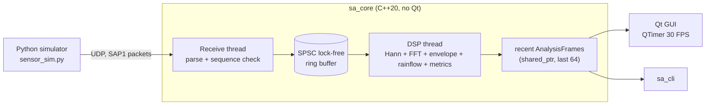

# Signal Analyzer

Real-time vibration signal analyzer: a Python sensor simulator streams samples over UDP,
a multithreaded C++20 pipeline computes the spectrum and signal metrics, and a Qt 6
desktop app displays the waveform, FFT and a scrolling spectrogram live.

<!-- TODO: add a GIF of the running app here -->

## Features

- **Lock-free SPSC ring buffer** between the network and DSP threads (acquire/release
  atomics, cache-line separated counters, no allocation on the hot path)
- **Two worker threads** (`std::jthread` + `std::stop_token`), UI decoupled at ~30 FPS
- **Own radix-2 FFT**, Hann window with amplitude-correct scaling, sub-bin dominant
  frequency via parabolic interpolation
- **Envelope analysis** for bearing faults: band-pass and Hilbert transform in one
  frequency-domain step, envelope spectrum with harmonic markers, peak prominence to tell
  a fault line from noise; the band is tunable while running
- **Bearing defect frequencies** (FTF, BPFO, BPFI, BSF) from geometry and shaft speed,
  verified against the CWRU 6205 reference; the envelope peak is matched to the closest
  defect harmonic ("BPFO 1× (outer race), −1.0 %")
- **Fatigue:** streaming rainflow counting (ASTM E1049, checked against its worked
  example) of every sample into a range × mean rainflow matrix, Palmgren-Miner damage on
  a single-slope, endurance-limit or two-slope (EN 1993-1-9) S-N curve, Goodman / Gerber
  mean-stress correction, damage rate and estimated life, damage share per stress range
- **Metrics:** RMS, peak, crest factor, dominant frequency, envelope peak, bearing diagnosis
- **Link diagnostics:** lost packets (sequence gaps), malformed packets, buffer overruns
- **Cross-platform sockets** (BSD sockets / Winsock) behind a small RAII wrapper
- **Qt 6 GUI** with a custom `QPainter` plot (min/max decimation per pixel, no QtCharts)
- **Spectrogram (waterfall)** aligned with the spectrum plot: every analysis frame becomes
  a row (no frames skipped by the 30 FPS UI), rendered once into a ring of image lines
- **Headless CLI** (`sa_cli`) running the same pipeline
- **Tests:** GoogleTest unit + loopback integration tests, run under ThreadSanitizer
  and AddressSanitizer in CI on Linux and Windows

## Architecture



The receive thread only parses and copies samples, so DSP work never delays reading the
socket. If the consumer falls behind, the ring buffer reports dropped samples instead of
blocking the producer.

### Wire format (little-endian)

| Offset | Size | Field                            |
|-------:|-----:|----------------------------------|
| 0      | 4    | magic `0x31504153` ("SAP1")      |
| 4      | 4    | sequence number                  |
| 8      | 4    | sample rate [Hz]                 |
| 12     | 2    | sample count N (≤ 4096)          |
| 14     | 2    | channel (reserved, 0)            |
| 16     | 4·N  | float32 samples                  |

## Build

Requirements: CMake ≥ 3.21, a C++20 compiler (GCC 11+, Clang 14+, MSVC 2022),
Qt 6.3+ (Widgets) for the GUI, Python 3.10+ with NumPy for the simulator.
GoogleTest is fetched automatically.

```bash
# Linux / macOS
cmake -S . -B build -DCMAKE_PREFIX_PATH=/path/to/Qt/6.7.2/gcc_64
cmake --build build -j
ctest --test-dir build --output-on-failure
```

```powershell
# Windows (Developer PowerShell for VS 2022)
cmake -S . -B build -DCMAKE_PREFIX_PATH=C:\Qt\6.7.2\msvc2019_64
cmake --build build --config Release
ctest --test-dir build -C Release --output-on-failure
C:\Qt\6.7.2\msvc2019_64\bin\windeployqt.exe build\Release\signal_analyzer.exe
```

With the MinGW kit from the Qt online installer, use the compiler and Ninja shipped in
`C:\Qt\Tools` (adjust the Qt and MinGW versions to your install):

```powershell
# Windows, Qt MinGW kit (plain PowerShell)
$env:PATH = "C:\Qt\Tools\mingw1310_64\bin;C:\Qt\Tools\Ninja;C:\Qt\6.12.0\mingw_64\bin;$env:PATH"
cmake -S . -B build -G Ninja -DCMAKE_BUILD_TYPE=Release -DCMAKE_PREFIX_PATH=C:\Qt\6.12.0\mingw_64 -DCMAKE_CXX_COMPILER=g++
cmake --build build
ctest --test-dir build --output-on-failure
C:\Qt\6.12.0\mingw_64\bin\windeployqt.exe build\signal_analyzer.exe
```

Without Qt, pass `-DSA_BUILD_GUI=OFF`; the core library, CLI and tests still build.

Sanitizer builds (GCC/Clang):

```bash
cmake -S . -B build-tsan -DSA_BUILD_GUI=OFF -DSA_SANITIZER=thread -DCMAKE_BUILD_TYPE=Debug
cmake --build build-tsan -j && ctest --test-dir build-tsan
```

## Run

```bash
pip install -r simulator/requirements.txt
python simulator/sensor_sim.py                    # 50 Hz + harmonics, light noise
./build/signal_analyzer                           # press Start
# or headless:
./build/sa_cli --port 5005 --fft 4096 --env-band 1000:4000 --rpm 3000 --bearing 9:7.94:39.04:0
```

Simulator scenarios:

```bash
python simulator/sensor_sim.py --tones 120:1,240:0.3 --noise 0.1
python simulator/sensor_sim.py --fault-hz 87 --fault-amp 2   # bearing-like impacts -> crest factor rises
python simulator/sensor_sim.py --drop 0.02                   # 2 % packet loss -> visible in "Link"
python simulator/sensor_sim.py --offset 0.5                  # static load -> cycles get a mean
python simulator/sensor_sim.py --help
```

### Envelope analysis

A local bearing defect (a spall on a race) is hit by every rolling element that passes
it. Each impact rings a structural resonance for a few milliseconds, so the fault shows up
as bursts of high-frequency vibration repeating at the fault rate (BPFO, BPFI, ...). In
the plain spectrum this energy is smeared around the resonance and easy to miss; the
rotation tones dominate.

The DSP thread therefore also computes an **envelope spectrum**:

1. keep only the band around the resonance (default 1000–4000 Hz),
2. demodulate: the magnitude of the analytic signal (Hilbert transform) is the envelope
   of the bursts,
3. take the spectrum of the envelope: the burst repetition rate and its harmonics appear
   as clear lines.

Steps 1 and 2 are a single frequency-domain operation: FFT, keep the positive-frequency
bins in the band (doubled), inverse FFT, magnitude. The GUI marks the first five harmonics
of the strongest line, and reports how far it stands above the median of the envelope
spectrum. Noise alone reaches ~12–14 dB, a real fault line 30 dB or more, so lines under
20 dB are reported as "none".

Try it with `python simulator/sensor_sim.py --fault-hz 87 --fault-amp 0.3`: the raw
spectrum shows only the 50 Hz harmonics, the envelope spectrum shows 87 Hz, 174 Hz, ...
If the resonance is elsewhere (`--resonance-hz`), move the envelope band to cover it.

### Bearing defect frequencies

Where a defect sits decides how often it is hit. With `n` rolling elements, ball diameter
`d`, pitch diameter `D`, contact angle `θ` and shaft frequency `fr` (rpm / 60), assuming a
rotating inner and a stationary outer race:

| Frequency | Defect on       | Formula                                                                  |
|-----------|-----------------|--------------------------------------------------------------------------|
| FTF       | cage            | `fr/2 · (1 − d/D·cos θ)`                                                 |
| BPFO      | outer race      | `n·fr/2 · (1 − d/D·cos θ)`                                               |
| BPFI      | inner race      | `n·fr/2 · (1 + d/D·cos θ)`                                               |
| BSF       | rolling element | `D/(2d) · fr · (1 − (d/D·cos θ)²)`; a ball defect hits a race at 2 × BSF |

The **Bearing** panel (GUI) or `--rpm` / `--bearing` (CLI) compute them; the defaults are
the SKF 6205 from the CWRU bearing dataset, and the unit tests check the published
multiples (BPFO 3.5848, BPFI 5.4152, FTF 0.3983, 2·BSF 4.7135 × shaft speed). The
expected frequencies are marked on the envelope spectrum, and a clear envelope line is
matched to the closest defect harmonic (1×–5×) within 3 %: real bearings slip, so lines
sit 1–2 % below the kinematic value.

At 3000 rpm (the simulator's 50 Hz tone) the 6205 has BPFO = 179.24 Hz and
BPFI = 270.76 Hz. To see an outer race fault with 1 % slip diagnosed:

```bash
python simulator/sensor_sim.py --fault-hz 177.5 --fault-amp 0.3
./build/sa_cli --rpm 3000     # ... match=BPFO 1x (-1.0%)
```

### Fatigue: rainflow counting and Miner's rule

Every sample (not only the analysed FFT windows) goes through a streaming **rainflow**
counter, the four-point variant of ASTM E1049-85: only reversals are kept, a cycle closes
when its range is enclosed by both neighbouring ranges, and what is left open (the
residue) counts as half cycles. Feeding the history in chunks gives exactly the same
cycles as counting it in one piece; the unit tests check this and the standard's worked
example.

Closed cycles go into a **rainflow matrix** (range × mean) whose axes widen automatically
to the largest values seen. Each cell keeps the sums of its ranges and means, so damage
uses the true averages per cell, not bin centres. Damage is the **Palmgren-Miner** sum
`D = Σ nᵢ / Nᵢ`. D = 1 is the predicted end of life; the estimated life is the signal
time divided by D, assuming the load stays the same.

The S-N curve `N(Δσ)` comes in three shapes (`Δσ_C` = detail category, the range that
survives `N_C` = 2·10⁶ cycles):

| Shape                     | Cycles to failure                                                | Below the limit          |
|---------------------------|------------------------------------------------------------------|--------------------------|
| Two slopes (default)      | `N_C·(Δσ_C/Δσ)^m` above the knee, `N_D·(Δσ_D/Δσ)^m₂` below it    | no damage under `Δσ_L`   |
| Endurance limit           | `N_C·(Δσ_C/Δσ)^m`                                                | no damage under `Δσ_D`   |
| Single slope              | `N_C·(Δσ_C/Δσ)^m`                                                | every cycle counts       |

The defaults follow EN 1993-1-9 for welded steel: m = 3, knee at `N_D` = 5·10⁶ cycles,
m₂ = 5, cut-off at `N_L` = 10⁸ cycles. That gives `Δσ_D = 0.737·Δσ_C` and
`Δσ_L = 0.549·Δσ_D` (66.3 and 36.4 MPa for category 90), which the unit tests check.

**Mean-stress correction** turns a cycle with a tensile mean `σm` into the zero-mean range
that does the same damage: Goodman `Δσ / (1 − σm/R_m)` or Gerber
`Δσ / (1 − (σm/R_m)²)`, with `R_m` the ultimate tensile strength. Compressive means are
not credited (conservative). The default is no correction: for welded joints EN 1993-1-9
and IIW leave it out, because residual stresses near yield dominate the mean anyway.
Goodman is the usual conservative choice for unwelded parts, Gerber fits ductile steels
better.

Because damage is computed from the matrix outside the DSP thread, the calibration, the
S-N curve and the mean-stress correction can change while running without recounting.
**Reset counting** (GUI) starts over.

The simulator produces acceleration, not stress. Fatigue needs stress, so the
**stress scale** (MPa per signal unit, e.g. from a strain gauge or an FE transfer
function) converts it. Without a real calibration D is a relative damage, useful for
comparing load conditions but not as an absolute life.

A case you can check by hand: a pure 50 Hz sine of amplitude 1 at 50 MPa per unit is
50 cycles/s of 100 MPa range. With 2·10⁶ cycles at 100 MPa the life is
2·10⁶ / 50 s = 11.1 h:

```bash
python simulator/sensor_sim.py --tones 50:1 --noise 0
./build/sa_cli --stress-scale 50 --sn 3:100:2e6   # ... life=11.1 h
```

`--sn` takes 3 values for a single slope, 4 (`…:N_D`) for an endurance limit and 6
(`…:N_D:m₂:N_L`) for two slopes; without it the EN 1993-1-9 defaults apply. With a static
load (`--offset`, here 25 MPa) Goodman at `R_m` = 100 MPa scales the range by
1 / (1 − 0.25), the damage by (4/3)³ = 2.37, and the life drops to 4.7 h:

```bash
python simulator/sensor_sim.py --tones 50:1 --noise 0 --offset 0.5
./build/sa_cli --stress-scale 50 --sn 3:100:2e6 --mean-stress goodman:100   # ... life=4.7 h
```

## Project layout

```
core/      sa_core library: Protocol, SpscRingBuffer, Dsp (FFT, envelope), Bearing, Fatigue,
           Udp, Pipeline
app/       Qt 6 GUI: MainWindow, PlotWidget, SpectrogramWidget, BearingPanel, FatiguePanel,
           PlotFrame (shared axes)
cli/       headless front-end
tests/     GoogleTest unit and integration tests
simulator/ Python UDP sensor simulator
```

## Roadmap

- [x] Spectrogram (waterfall) view
- [x] Envelope analysis for bearing fault frequencies
- [x] Bearing fault frequency calculator (BPFO/BPFI/BSF/FTF from geometry and shaft speed)
- [x] Rainflow cycle counting and fatigue damage estimate (Miner's rule)
- [x] Fatigue refinements: endurance limit / two-slope S-N curve, mean-stress correction
- [ ] Multi-channel streams
- [ ] Recording to file / replay (CSV, HDF5)
- [ ] ESP32 + MEMS accelerometer as a real sensor
- [ ] Benchmark: sustained sample rate vs. FFT size
